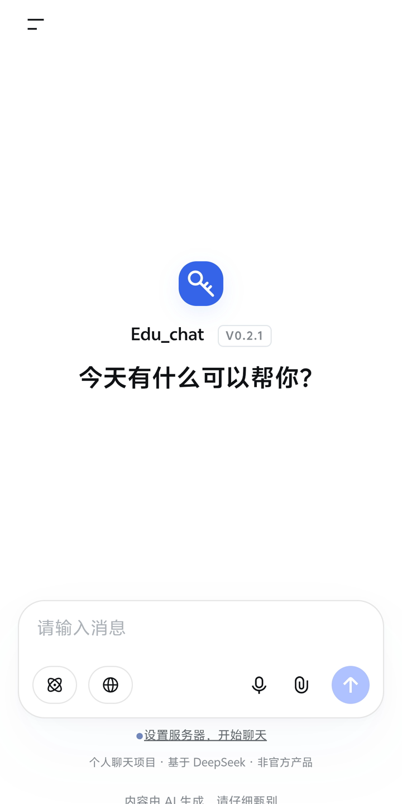
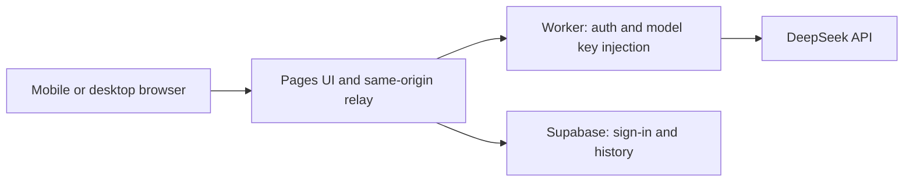

# Edu_chat

**A DeepSeek chat client you can make your own.**

A small open-source project, built from [DeepSeek's official chat-demo](https://github.com/deepseek-ai/chat-demo), starting with the mobile browser experience. Email sign-in, personal cloud history and Android support are being developed around that foundation. **An independent project, not an official DeepSeek product.**

[中文](README.md) · [English](README.en.md) · [Deployment](docs/SERVERLESS.md) · [Verification log](docs/VERIFICATION.md) · [Report an issue](https://github.com/pc-cccc/edu_chat/issues)

> **Milestone — November 19, 2026: a real AI reply received in a mobile browser.**
> V0.2.2 is still in development. 54 local tests pass; that does not mean every feature has passed real-device testing.

<p align="center"></p>
<p align="center"><sub>V0.2.1 interface preview. The current web build uses email sign-in instead of the connection setup shown here.</sub></p>

## What this project is working toward

A chat tool that feels comfortable on a phone, with a clear interface and a deployment you can understand.

- **An interface you can change:** React and TypeScript, retaining the upstream Markdown, math and diagram rendering.
- **A server-held model key:** in the current cloud mode, the Worker injects the maintainer's DeepSeek key; it is not embedded in the browser bundle or APK.
- **Account-scoped data:** Supabase sign-in, per-account local caches and cloud history are wired up. Local isolation tests exist; cross-device acceptance is still pending.
- **An honest development log:** an implemented button is not the same as a tested feature. Fixes and limitations are documented.

The latest fix addresses “the website loads, but sending a message fails.” Web chat, sign-in and history now use a same-origin Pages relay. It worked in the current phone test; **availability without a proxy is not guaranteed across all regions, networks or browsers.**

## What has actually been verified

| Area | Current status |
| --- | --- |
| Database, Worker and Pages deployment | Complete |
| Real text conversation in a mobile browser | **Confirmed by the user** |
| Auth, database permissions, relay, cancellation, session lookup timeout | Covered by local automated tests; 54 tests pass |
| Cross-device history, sign-in restoration, two real accounts | Implemented; cloud acceptance pending |
| Visible streaming and stopping generation | Implemented; dedicated device testing pending |
| Thinking, search, attachments and voice | UI / integrations present; live testing pending and provider capabilities apply |
| Android | Capacitor project and an older test APK exist; current cloud APK is unfinished |
| PC switched off, phone chatting over mobile data | Separate acceptance test pending |

The current UI is general-purpose chat. There is no education home screen or education-specific system prompt; the visualization component is only a reserved extension point.

## Hosting and model costs

**You do not need to rent and maintain an always-on server for the current setup. You do use managed backend services.**

- Cloudflare Pages / Functions and Workers host the UI and relay. Free plans have request and CPU limits.
- Supabase provides sign-in and history, with free-plan storage and transfer limits.
- DeepSeek generates replies. **The current shared-key deployment charges model usage to the maintainer's account.**

Open-source software does not mean free model usage or unlimited free hosting. A public repository is not an offer of unlimited free chat.

Bring-your-own-key (BYOK) with local history is a possible lower-cost direction. An early `direct` mode remains in the code, but secure credential storage, native streaming and network compatibility have not been fully validated. The current deployed product has not switched to BYOK.

## Try the interface locally

Node.js 22.12+ is required. On Windows, use `npm.cmd` if PowerShell blocks `npm.ps1`.

```powershell
git clone https://github.com/pc-cccc/edu_chat.git
cd edu_chat
npm ci
npm run demo
```

Open `http://127.0.0.1:8092`. This is a fixed-response demo: no key or paid model request is needed.

For a real deployment, follow the [serverless guide](docs/SERVERLESS.md), configure your own accounts and public build variables, and run `npm run build:serverless`. Deploy the complete `dist` output, including the Pages Function. Never commit environment files, database passwords, private keys or Android signing files.

## Current web architecture



Android still has separate build and connection settings; this diagram does not represent a completed new APK. See the [Android guide](docs/ANDROID.md). The old Node gateway and Dockerfile remain for reference, not for the current cloud deployment.

## Next up

- [ ] Verify sign-in restoration, cross-device history and account isolation.
- [ ] Test stopping generation, thinking, search and attachments.
- [ ] Complete the new Android connection path, build and device tests.
- [ ] Evaluate BYOK and local-first operation with explicit cost ownership.

If this is a tool you would use, **star the repository** to follow its progress. Issues and PRs are welcome. Reproduction steps and specific mobile-browser errors help; please leave out credentials and private conversations.

Developer checks: run `npm --prefix workers ci`, then `npm run type`, `npm run lint` and `npm test`.

## Credits and license

Thanks to DeepSeek's official chat-demo for the foundation. Upstream copyright and the [MIT license](LICENSE) are retained; see [NOTICE.md](NOTICE.md) for attribution. The Edu_chat name and key icon identify this independent project.
