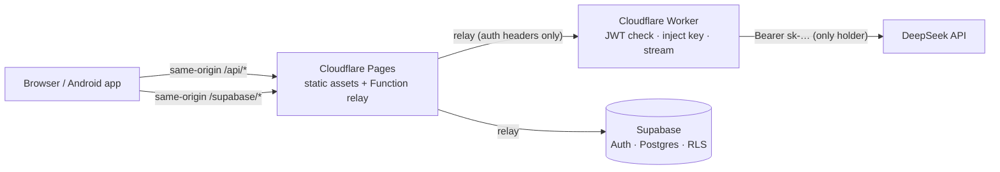

# Edu_chat — a DeepSeek chat client that keeps your API key inside the Worker

> A DeepSeek chat app you can actually deploy for yourself and your friends: **Cloudflare Pages** for the UI, **Cloudflare Worker** as the gateway, **Supabase** for sign-in and cloud history.
>
> **The DeepSeek key lives only in a Worker Secret — the frontend bundle, the Android APK and the database never see it.**

[](LICENSE)
[](tests)
[](#-real-status-as-of-2026-11-19)
[](README.md)

<p align="center"></p>

## Why this exists

You want DeepSeek chat without shipping your API key to the browser (open DevTools and it is gone), and you want your phone to keep the same account and history.

The upstream chat-demo only runs locally: no sign-in, no cloud history. Most "wrapper" sites either embed the key in the frontend or hide it behind someone else's server.

This project splits the concerns properly: **the key stays server-side, identity is issued by Supabase, history is per account**. The frontend is just a shell — reading its source reveals nothing about your key.

## ✨ What it solves

- 🔐 **Key never reaches the client**: the DeepSeek key is a Worker Secret. Login state is verified against Supabase JWTs (JWKS); anonymous and `service_role` keys are rejected, and file ownership is checked per request.
- 🧱 **Isolation that is enforced, not decorative**: RLS is on for all 7 tables, so an account can only read its own rows. Sign in elsewhere and your history follows; sign in as someone else and it does not.
- 📶 **Works from mainland China**: `*.workers.dev` is frequently reset there, so the web build talks to its **own origin** (`/api/*`, `/supabase/*`) and a Pages Function relays to the Worker and Supabase in the cloud. No proxy needed on the phone.
- 🪶 **Zero-cost hosting**: Pages + Workers + Supabase free tiers; you only pay DeepSeek for actual usage.
- 💬 **A real chat experience**: token-by-token streaming, stop generation, deep thinking, web search, file upload, Markdown / LaTeX / Mermaid.
- 📱 **One codebase, two targets**: the same frontend builds into an installable Android APK — chat from your phone with your PC off.

## 🧩 Architecture



| Layer | Service | Role |
| --- | --- | --- |
| Frontend | Cloudflare Pages | the web / Android UI; same-origin API relay |
| Gateway | Cloudflare Worker | verifies login, injects the DeepSeek key, streams, rate-limits, checks file ownership |
| Data | Supabase | email auth, private cloud history, file ownership, RLS |

**Why the extra relay hop?** Connecting to `*.workers.dev` directly is unreliable on mainland Chinese networks. With same-origin `/api/*`, the browser only talks to its own domain and Cloudflare does the hop internally. The relay allows a fixed set of routes only, forwards no cookies, offers no arbitrary-URL or admin proxying, refuses redirects, and its upstream origins are baked in at build time.

## 📊 Real status (as of 2026-11-19)

No "fully supported" marketing here — this is where the project actually stands:

| Capability | Status |
| --- | --- |
| Cloud schema: 7 tables + RLS + 3 triggers + Realtime (script self-checks) | ✅ done |
| Worker gateway: JWT check / service_role rejection / CORS / rate limit / streaming | ✅ deployed & verified |
| Pages deploy + same-origin relay | ✅ live |
| **Real text chat from a mobile browser (actual answer received)** | ✅ verified |
| Cross-device history, history after re-login | ⬜ pending |
| Two accounts cannot see each other's data | ⬜ pending (covered by local tests) |
| Visual streaming confirmation, stop generation | ⬜ pending |
| Deep thinking / web search / attachments / voice | ⬜ pending (needs real quota) |
| New Android APK build | ⬜ pending |
| PC off + phone on mobile data | ⬜ pending re-test |

Every step, command output and dead end is recorded in [VERIFICATION.md](docs/VERIFICATION.md).

## 🚀 Deploy in three steps

Prerequisites: a Cloudflare account, a Supabase project, a DeepSeek API key. Full walkthrough: [serverless deployment guide](docs/SERVERLESS.md).

```powershell
# 1) Create the schema (hidden prompts; nothing is written to disk or shell history)
npm run db:setup

# 2) Deploy the Worker and store the secret
cd workers
npx wrangler secret put DEEPSEEK_API_KEY
npx wrangler deploy

# 3) Build and deploy the frontend
cd ..
Copy-Item .env.serverless.example .env.serverless   # WORKER_ORIGIN / SUPABASE_URL / SUPABASE_ANON_KEY
npm run build:serverless
npx wrangler pages deploy dist --project-name=<your-project>
```

Afterwards set **Authentication → URL Configuration** in Supabase to your Pages domain, otherwise confirmation emails point at `localhost`.

## ✅ Verify locally

```powershell
npm ci
npm --prefix workers ci
npm run type
npm run lint
npm test        # 54 tests: schema & two-role RLS isolation, Worker auth/CORS/cancel/file ownership, relay allow-list, session timeout
```

## ⚠️ Known limitations

- **The bill is on the model side**: hosting is free, DeepSeek is metered. The in-memory rate limiter is not a spending cap — keep public signups closed or invite-only.
- **Pages Functions consume Workers quota**; free-tier terms and reachable regions change over time. No promise of permanent free hosting.
- **Realtime (multi-user) still uses the native Supabase origin**; the same-origin relay does not cover WebSockets, and there is no multi-user UI yet.
- **The Android build connects directly** to its configured backend — bring your own reachable entry point.
- No end-to-end encryption: a database admin could read plaintext history.
- Concurrent cross-device editing and offline conflict merging are not implemented.

## 🗺️ Roadmap

- [x] Cloud schema script with self-check and rollback
- [x] Worker gateway with key isolation
- [x] Same-origin relay for reachability
- [x] Real chat from a mobile browser
- [ ] Formal acceptance: cross-device history, two-account isolation, streaming & stop
- [ ] Deep thinking, web search, attachments, voice
- [ ] New Android APK (same signing key)
- [ ] Invite-only signup and usage warnings

## ⭐ If this helps you

The combination of **key-only-in-Worker + same-origin relay + RLS isolation** applies to anyone building their own AI chat site. If the code or the debugging notes saved you time, a **Star** is appreciated — it tells me this is worth maintaining.

Issues and pull requests are welcome.

## 📄 License

Upstream MIT license — see [LICENSE](LICENSE). The name and icon are a personal project identity; this is **not** an official DeepSeek product and does not impersonate one.
