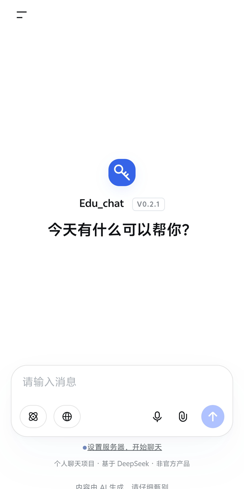
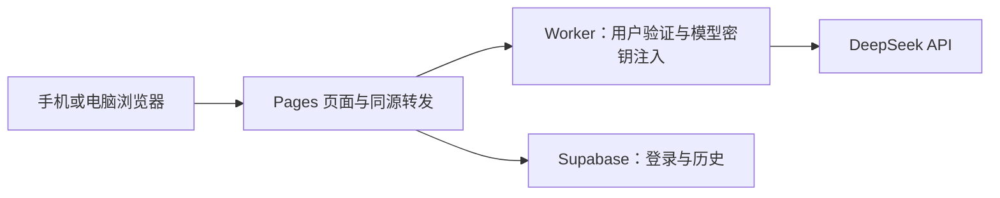

# Edu_chat

**把 DeepSeek 聊天，做成自己顺手的工具。**

一个从手机浏览器开始打磨的开源聊天客户端。基于 [DeepSeek 官方 chat-demo](https://github.com/deepseek-ai/chat-demo)，保留简洁的聊天界面，逐步补上邮箱登录、个人云端历史和 Android 支持。**独立个人项目，非 DeepSeek 官方产品。**

[中文](README.md) · [English](README.en.md) · [部署指南](docs/SERVERLESS.md) · [实际验证记录](docs/VERIFICATION.md) · [反馈问题](https://github.com/pc-cccc/edu_chat/issues)

> **最新进展：2026-11-19，手机浏览器已收到真实 AI 回复。**
> 目前版本 V0.2.2，仍在开发。54 项本地测试通过；真实设备上哪些已测、哪些未测，见下表。

<p align="center"></p>
<p align="center"><sub>界面预览来自 V0.2.1；当前网页版使用邮箱登录，旧图不代表最新版连接方式。</sub></p>

## 想做成什么样

打开手机就能继续聊天，界面清楚，部署方式看得懂。先把每天会用的功能做好，再往上加东西。

- **界面自己掌控**：React + TypeScript，沿用上游聊天体验，保留 Markdown、数学公式和图表渲染。
- **模型密钥留在后端**：当前云端模式由 Worker 注入维护者的 DeepSeek Key，不把它打包进网页或 APK。
- **账号和历史有边界**：已接入 Supabase 登录、按账号缓存及云端历史；数据库隔离有本地测试，跨设备体验还在验收。
- **记录真实进展**：不把“按钮已经画好”当成“功能已经测通”。失败原因、修复和测试边界都留在验证记录里。

最近修复的是手机“网页能打开，发消息却报网络异常”：网页版增加同源转发，让聊天、登录与历史请求经 Pages 到达后端。**已在当前手机测试中跑通，不承诺所有地区、网络或浏览器都无需代理。**

## 现在能用到哪一步

| 项目 | 当前状态 |
| --- | --- |
| 数据库、Worker、Pages 部署 | 已完成 |
| 手机浏览器真实文本问答 | **用户实测通过** |
| 鉴权、数据库权限、转发、取消、登录等待超时等 | 本地自动测试覆盖，54 项通过 |
| 跨设备历史、重登恢复、真实两账号隔离 | 已接线，待真实环境验收 |
| 逐字显示与停止生成 | 已实现，待真机专项验收 |
| 深度思考、搜索、附件、语音 | 已有界面 / 接口，待逐项联调；能力取决于模型服务 |
| Android | 已有 Capacitor 工程和旧版测试包；最新版云端 APK 待完成 |
| 电脑关机后，手机移动网络继续聊天 | 待单独复测 |

当前没有教育首页入口或学习助手专用提示。`VisualizationSlot.tsx` 只保留扩展接口。

## 需要租服务器吗？费用谁承担？

**当前方案不需要自己租一台常驻云服务器，但确实使用了托管后端。**

| 部分 | 当前用途 | 费用边界 |
| --- | --- | --- |
| Cloudflare Pages / Functions + Worker | 网页、转发、鉴权 | 可从免费套餐起步，受请求量、CPU 等限制 |
| Supabase | 登录、数据库、历史 | 有免费套餐，受存储、流量等限制 |
| DeepSeek API | 生成回答 | 当前使用维护者的 Key，调用费用由维护者承担 |

**开源免费 ≠ 模型调用免费，也不等于永久免费托管。** 公开源码不代表向所有访客提供无限免费聊天。

“用户自带 Key（BYOK）+ 本地历史”是降低维护者成本的候选方向；本仓库保留了早期 direct 模式，但不代表安全存储、原生流式和各网络环境已完成验证。当前发布版尚未切换成 BYOK 产品。

## 先在本地看看

需要 Node.js 22.12+。Windows 执行策略拦截 npm.ps1 时使用 `npm.cmd`。

```powershell
git clone https://github.com/pc-cccc/edu_chat.git
cd edu_chat
npm ci
npm run demo
```

打开 `http://127.0.0.1:8092`。演示使用固定回复，无需密钥，不调用真实模型。

准备部署时，按 [Serverless 指南](docs/SERVERLESS.md) 配置自己的账号和公开构建变量，再运行 `npm run build:serverless`。必须完整部署 `dist` 中的 Pages Function 与静态文件。不要提交 `.env`、数据库密码、私钥或 Android 签名。

## 当前网页版的链路



Android 目前仍使用单独的构建与连接配置，不能把上图当成新版 APK 已完成的证明。见 [Android 指南](docs/ANDROID.md)。旧 `server/` 和 Dockerfile 保留作参考，不用于当前云端部署。

## 下一步

- [ ] 验收重登、跨设备历史与账号隔离。
- [ ] 验收停止生成、深度思考、搜索和附件。
- [ ] 完成新版 Android 联网入口、打包与真机测试。
- [ ] 评估用户自带 Key 与本地优先模式，明确费用归属。

想一起把这个小项目做顺手，欢迎提 Issue、提交 PR，或点一个 **Star** 关注后续。手机上的具体问题、复现步骤和报错，比一句“不能用”更能帮助修复；请不要附上密钥或私人聊天。

开发检查：`npm --prefix workers ci`，然后 `npm run type`、`npm run lint`、`npm test`。

## 致谢与许可

感谢 DeepSeek 官方 chat-demo 提供基础界面与协议实现。保留上游版权与 [MIT LICENSE](LICENSE)，来源和修改说明见 [NOTICE.md](NOTICE.md)。Edu_chat 的名称和钥匙图标用于标识本个人项目。
