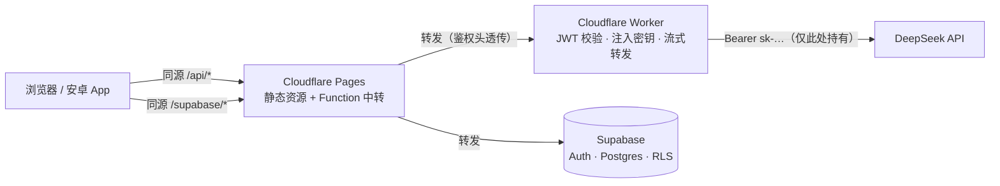

# Edu_chat · 把 DeepSeek 密钥锁进 Worker 的聊天客户端

> 一个可以真正部署给自己和朋友的 DeepSeek 聊天应用：**Cloudflare Pages** 做界面、**Cloudflare Worker** 当网关、**Supabase** 管登录与云端历史。
>
> **DeepSeek 密钥只存在 Worker Secret 里——前端代码、安卓 APK、数据库都拿不到它。**

[](LICENSE)
[](tests)
[](#-真实进度截至-2026-11-19)
[](README.en.md)

<p align="center"></p>

## 为什么会有这个项目

想用 DeepSeek 聊天，又不想把 API Key 塞进浏览器（F12 一看就泄露），还想让手机也能随时聊、历史和账号跟着走。

官方 chat-demo 只能本机跑，没有登录、没有云端历史；市面上的"套壳站"大多把 key 放在前端或自己的服务器上。

这个项目把这三件事拆开做干净：**密钥在服务端、身份由 Supabase 签发、历史各存各的**。前端只是一层壳，随便被人拿走看源码也不会有你的 key。

## ✨ 它解决了什么

- 🔐 **密钥永不进前端**：DeepSeek Key 只存 Worker Secret。登录态用 Supabase JWT 的 JWKS 验签，拒绝匿名 key、拒绝 service_role key，附件归属逐条校验。
- 🧱 **身份不是摆设**：7 张表全部开启 RLS，同一张表里每个人只能读到自己那几行；换设备能看到自己的历史，换账号看不到别人的。
- 📶 **国内手机直连也不断**：`*.workers.dev` 在国内常被重置，所以网页端走**同源中转**——浏览器只和自己的 Pages 域名通信（`/api/*`、`/supabase/*`），由 Pages Function 在云端转发到 Worker 和 Supabase。手机上不需要挂代理。
- 🪶 **0 元起跑**：Pages + Workers + Supabase 全在免费额度内，只有调 DeepSeek 才按量计费。
- 💬 **正经的聊天体验**：流式逐字输出、停止生成、深度思考、联网搜索、文件上传、Markdown / LaTeX / Mermaid。
- 📱 **一套代码两端**：同一份前端可打包成安卓 APK，电脑关机后手机照样聊。

## 🧩 架构



| 层 | 用谁 | 干什么 |
| --- | --- | --- |
| 前端 | Cloudflare Pages | 网页 / 安卓 App 的同一套界面；同源中转 API |
| 网关 | Cloudflare Worker | 校验登录、注入 DeepSeek Key、流式转发、限流、附件归属 |
| 数据 | Supabase | 邮箱登录、个人云端历史、文件归属、RLS 隔离 |

**为什么多一层 Pages 中转？** 直连 Worker 的话，国内网络经常连不上 `*.workers.dev`。改成同源 `/api/*` 后，浏览器只认自己的域名，中转由 Cloudflare 内部完成。中转只放行固定几条路由，不转发 cookie、不提供任意 URL 代理、不跟随重定向，上游地址在构建时写死。

## 📊 真实进度（截至 2026-11-19）

不喜欢 README 里写"已完美支持"，所以把实际状态列出来：

| 能力 | 状态 |
| --- | --- |
| 云端数据库：7 张表 + RLS + 3 触发器 + Realtime（脚本自检） | ✅ 已建 |
| Worker 网关：JWT 校验 / 拒绝 service_role / CORS / 限流 / 流式 | ✅ 已部署并验证 |
| Pages 部署 + 同源中转 | ✅ 已上线 |
| **手机浏览器真实文本聊天（收到真实回答）** | ✅ 已实测 |
| 跨设备历史、重新登录后历史回填 | ⬜ 待验收 |
| 两个账号互相看不到数据 | ⬜ 待验收（本地测试已覆盖） |
| 逐字流式的视觉确认、停止生成 | ⬜ 待验收 |
| 深度思考 / 联网搜索 / 附件 / 语音 | ⬜ 待逐项验收（需真实额度） |
| 新版 Android APK | ⬜ 待打包 |
| 电脑关机 + 手机移动网络独立可用 | ⬜ 待复测 |

每一步的原始记录、命令输出和失败原因都写在 [验证记录](docs/VERIFICATION.md) 里——包括踩过的坑。

## 🚀 三步上云

前置：Cloudflare 账号、Supabase 项目、DeepSeek API Key。详细图文步骤见 [Serverless 部署指南](docs/SERVERLESS.md)。

```powershell
# 1) 建表（隐藏输入连接串与数据库密码，不落盘、不进历史）
npm run db:setup

# 2) 部署 Worker，并写入密钥
cd workers
npx wrangler secret put DEEPSEEK_API_KEY
npx wrangler deploy

# 3) 构建并部署前端
cd ..
Copy-Item .env.serverless.example .env.serverless   # 填 WORKER_ORIGIN / SUPABASE_URL / SUPABASE_ANON_KEY
npm run build:serverless
npx wrangler pages deploy dist --project-name=<你的项目名>
```

部署后在 Supabase 的 **Authentication → URL Configuration** 把 Site URL / Redirect URL 改成你的 Pages 域名，否则确认邮件会跳到 `localhost`。

## ✅ 本地自检

```powershell
npm ci
npm --prefix workers ci
npm run type
npm run lint
npm test        # 54 项：schema 与两角色 RLS 隔离、Worker 鉴权/CORS/取消/文件归属、Pages 中转白名单、登录态超时
```

## ⚠️ 已知限制

- **收费在模型侧**：托管是免费的，但 DeepSeek 按 token 计费。Worker 里的内存限流只能挡一时，**不能当作费用上限**；自用请关掉公开注册，或改成邀请制。
- **Pages Functions 会消耗 Workers 额度**，免费额度与可用地区随 Cloudflare 政策变化，不承诺永久免费。
- **Realtime（多人协作）走原生 Supabase 地址**，网页端的同源中转没有覆盖 WebSocket；目前也没有多人界面。
- **安卓版仍直连配置的后端**，需要你自己准备一个可访问的入口再打包。
- 没有端到端加密；数据库管理员理论上能读明文历史。
- 跨设备并发编辑、离线冲突合并尚未实现。

## 🗺️ 路线图

- [x] 云端建表脚本 + 结构自检 + 失败回滚
- [x] Worker 网关与密钥隔离
- [x] 网页版同源中转（国内可用性）
- [x] 手机浏览器真实聊天
- [ ] 跨设备历史 / 双账号隔离 / 流式与停止的正式验收
- [ ] 深度思考、联网搜索、附件、语音逐项验收
- [ ] 新版安卓 APK（沿用原签名）
- [ ] 邀请制注册与用量提示

## ⭐ 如果它帮到你

这套「**密钥只在 Worker + 同源中转 + RLS 隔离**」的组合，适合所有想给自己搭一个 AI 聊天站的人。如果代码或踩坑记录帮你少走了几步，欢迎点个 **Star** —— 它会让我知道这些东西值得继续维护。

有问题或想一起改，开 issue 就好。

## 📄 许可与声明

基于上游 MIT 许可，见 [LICENSE](LICENSE)。项目名与图标为个人项目标识，**不是 DeepSeek 官方产品**，也不冒充官方。`zhixue-chat` 旧版本地数据不会自动归入新账号。
